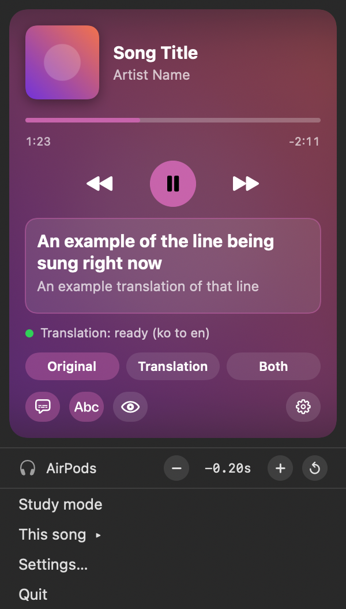
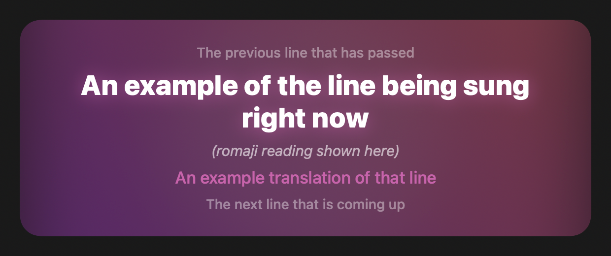

# SpotLyrics

Synced Spotify lyrics in the macOS menu bar, with on-device translation, pronunciation readings (romaji), and a language study mode.

SpotLyrics reads the song playing in the Spotify desktop app, fetches time-stamped lyrics from [LRCLIB](https://lrclib.net), and shows them in the menu bar, in a karaoke-style floating window, and on a player card inside the menu. Translation runs entirely on your device using Apple's Translation framework, so no lyrics are sent to a translation service.

<p align="center">
  
  &nbsp;&nbsp;
  
</p>

> The images above are rendered from the real app views with a made-up cover and sample lyrics.

## Table of contents

- [Features](#features)
- [Requirements](#requirements)
- [Installation](#installation)
- [Usage](#usage)
- [Settings](#settings)
- [Keyboard shortcuts](#keyboard-shortcuts)
- [How it works](#how-it-works)
- [Project structure](#project-structure)
- [Data and privacy](#data-and-privacy)
- [Testing](#testing)
- [Adding a display language](#adding-a-display-language)
- [Troubleshooting](#troubleshooting)
- [Limitations](#limitations)
- [Contributing](#contributing)
- [Acknowledgements](#acknowledgements)
- [License](#license)

## Features

**Lyrics**
- Synced lyrics from LRCLIB, shown line by line in the menu bar. Lines longer than 40 characters scroll slowly (marquee) instead of being cut off.
- A **floating lyrics** window in karaoke style: a large current line, dimmer lines before and after it, and the translation underneath. It stays above other windows, follows you across Spaces, and can be dragged anywhere.
- When LRCLIB has several versions of a song, the app prefers a version in the native script (Hangul, Kana) with a matching duration over a romanized one.
- Lyrics are cached on disk, so songs you have played before appear instantly and keep working offline.
- Per-output lyrics offset. Bluetooth outputs start with a −0.2 s compensation, and your adjustments are remembered per device (AirPods, speakers, and so on).

**Translation**
- On-device translation through Apple Translation, into the target language of your choice (19 languages supported).
- **Per-line language detection**, so mixed-language songs such as K-pop (Korean and English) are handled. Short lines like "oh oh" follow the lines around them.
- Lyrics-language modes: automatic, automatic limited to the languages you check, or one fixed language. You can also set the language per song, including "Japanese (romaji)" and "Korean (romanization)" for lyrics written in Latin letters.
- **Casual style**: smooths translations into Indonesian and English so they sound less formal (for example, "tidak" becomes "nggak", and "sangat cantik" becomes "cantik banget").
- Translations are cached per song and target language.

**Readings and study**
- **Readings** under the original lyrics: romaji for Japanese (kanji are read with proper Japanese readings) and Revised Romanization for Korean.
- **Study mode**: click a word to see its meaning, click a line to translate it, save words to a vocabulary list, and export it to Anki (`SpotLyrics-vocab.tsv`).

**Player and interface**
- A player card in the menu: album cover, a progress bar you can click or drag to seek, and previous, play/pause, and next buttons.
- An accent color taken from the album cover.
- A dedicated display while Spotify ads play, with a countdown in the menu bar.
- Global keyboard shortcuts, launch at login, and two interface languages (Indonesian and English) that switch instantly.

## Requirements

| | |
|---|---|
| macOS | **26 (Tahoe) or later.** The on-device translation API the app uses is only available from this version |
| Spotify | The desktop app (not the web player) |
| To build | Xcode or the Command Line Tools with Swift 6.2 or later |

Languages you want to translate from must be downloaded through macOS first. The app lists them in **Settings > Translation**, and the download itself is handled by the standard macOS dialog.

## Installation

There is no prebuilt release yet, so build the app from source.

```bash
git clone https://github.com/mohizzatulhaqi/spotlyrics.git
cd spotlyrics
./build.sh
open SpotLyrics.app
```

`build.sh` compiles every file in `Sources/`, creates the `SpotLyrics.app` bundle with its icon, and signs it ad hoc. Move `SpotLyrics.app` to `/Applications` if you like.

Things to know:

- **Automation permission.** On first launch macOS asks whether SpotLyrics may control Spotify. Allow it. If you denied it by mistake, turn it on in **System Settings > Privacy & Security > Automation**.
- **Target language question.** On first launch the app asks which language lyrics should be translated into. The default follows the app language or the system language.
- **Ad-hoc signature.** This is enough on the Mac that built the app. If you copy the `.app` to another Mac, Gatekeeper rejects it because it is not notarized. The simplest fix is to build it again on that Mac.
- **Launch at login** only works when the app runs as `SpotLyrics.app`, not as a bare binary.
- The build uses the architecture of the machine that builds it.

## Usage

Click the **♪** icon in the menu bar to open the menu.

### The player card

- **Cover, title, artist, and progress bar.** Click or drag the bar to jump to another position. The buttons below it go to the previous song, play or pause, and go to the next song.
- **The lyrics box** shows the line being sung (and its translation, when there is one).
- **Translation status** with a colored dot: green means ready, orange means working, red means failed. When it fails, **Download language** and **Try again** buttons appear.
- **Original / Translation / Both** controls what appears in the menu bar, the floating window, and Study mode.
- **The icon row:** floating lyrics, readings (shown only for Japanese or Korean songs), hide the menu bar lyrics, and Settings.

### The offset row

Shows the active audio output. The `−` and `+` buttons shift the lyrics by 0.1 s per click, and a reset button appears when the offset is not zero. Offsets are stored per audio device.

### Menu items

| Item | What it does |
|---|---|
| **Study mode** | Opens the study window (see below) |
| **This song** | Song language (shown when there is a foreign language to translate) and Reload lyrics from LRCLIB |
| **Settings…** (⌘,) | Opens the Settings window |
| **Quit** (⌘Q) | Quits the app |

### Study mode

A window that shows the whole lyrics with the current line highlighted.

- Click a **word** to see its meaning. For English lyrics, the definition from the built-in macOS dictionary is shown as well.
- Click a **line**, then press **Translate**, to translate that line.
- **Save word** adds the word, its meaning, the source line, and the song title to your vocabulary list.
- **Export to Anki** writes `SpotLyrics-vocab.tsv` to your Downloads folder. In Anki, choose File > Import and pick that file. The first column becomes the front of the card and the second column the back.

### Floating lyrics

Turn it on from the icon on the card, from Settings, or with **⌃⌥L**. Drag anywhere to move it and pull an edge to resize it. Its position and size are remembered. A **×** button appears when the pointer is over the window.

### Song language

If automatic detection gets a song wrong, or the lyrics are written in Latin letters, open **This song > Song language** and pick the language. **Japanese (romaji)** and **Korean (romanization)** first convert the Latin text to Hiragana or Hangul and then translate it, which gives much better results. The Korean conversion is not perfect, because Korean romanization is ambiguous by nature. The choice is stored per song.

## Settings

Open with **⌘,** or the **Settings…** menu item.

| Tab | Contents |
|---|---|
| **General** | App language (Follow system, Indonesia, English), launch at login, floating lyrics |
| **Translation** | Casual style, target language, lyrics-language mode, and a list of languages to download with their status |
| **Appearance** | Show readings (romaji), accent color from the cover |
| **Shortcuts** | A switch for global shortcuts and the list of shortcuts |

In the Translation tab, each language row shows **Installed**, **Download**, or **Not supported**. While a download runs you see a spinner and a running timer. macOS does not report a download percentage, so real progress is only visible in the system download dialog.

## Keyboard shortcuts

All of them use **⌃⌥** (Control + Option) and need no Accessibility permission.

| Keys | Action |
|---|---|
| ⌃⌥L | Turn floating lyrics on or off |
| ⌃⌥T | Switch display: Original, then Translation, then Original + translation |
| ⌃⌥H | Hide or show the menu bar lyrics |
| ⌃⌥[ | Lyrics slower (−0.1 s) |
| ⌃⌥] | Lyrics faster (+0.1 s) |

After each shortcut the menu bar shows a short message for about 1.5 seconds as feedback. If a combination is already taken by another app, the list in Settings marks it.

## How it works

```
Spotify ──(AppleScript + distributed notification)──▶ Snap (song, position, state)
                                                          │
                       position is computed locally between fetches
                                                          │
LRCLIB ◀── get / search ── Lyrics.load ──▶ disk cache ────┤
                                                          ▼
                                      Detect.perLine ─▶ Translator (Apple) ─▶ Casual
                                                          │
                                       Readings (romaji / romanization)
                                                          ▼
                    menu bar · menu card · floating window · Study mode
```

**Reading Spotify.** Track metadata, position, and state come from AppleScript. To save energy the app does not call AppleScript constantly. Spotify posts the distributed notification `com.spotify.client.PlaybackStateChanged` when the track, play/pause state, or position changes, and that is when the app fetches data. In between, the position is computed from the system clock while the state is "playing". As a safety net the data is resynchronized every 10 seconds while playing and every 30 seconds while paused.

**Fetching lyrics.** `Lyrics.load` queries LRCLIB (the `get` endpoint, then `search`), collects several versions, and picks one in the native script whose duration differs by at most 5 seconds. The result is stored on disk. A song that is not found is remembered for 24 hours, but only when the LRCLIB server was actually reachable, so nothing is wrongly recorded while you are offline.

**Detecting the language.** Each line is detected on its own. Hangul and Kana are recognized directly, and the rest uses `NLLanguageRecognizer` with a confidence threshold. Short or ambiguous lines inherit the language of the nearest line. The limited mode narrows the candidates, which improves accuracy for pairs such as Korean and English.

**Translating.** Lines are grouped by language, and each group is sent to a `TranslationSession` for its pair. A failure in one language (for example one that is not downloaded yet) does not fail the others. The raw Apple output is cached, while the casual-style rules are applied at display time, so switching casual style on or off takes effect without translating again.

**Readings.** For Japanese the app uses `CFStringTokenizer` with the Japanese locale, because the system's plain transliteration reads kanji as Mandarin pinyin. The particles は, へ, を are written `wa`, `e`, `o`, and a small っ doubles the following consonant. For Korean, a Revised Romanization converter is written in-house and handles sound changes between syllables, ㅎ dropping out, nasalization, and palatalization.

**Accent color.** The cover is downscaled to 32×32 pixels, bucketed into 12 hue groups, and weighted by saturation and brightness. The winning group is adjusted so it stays readable on a dark background.

## Project structure

```
Sources/
  main.swift                    app entry point
  Core/                         pure logic, Foundation only (covered by tests)
    Models.swift                Line, Snap, CachedLyrics
    Store.swift                 lyrics and translation cache on disk
    Prefs.swift                 preferences, target language, language names
    Strings.swift               Indonesian and English text tables, TransStatus
    Lyrics.swift                LRCLIB client, LRC parser, version selection
    Detect.swift                per-line language detection
    Readings.swift              romaji, Korean romanization, romaji-to-script conversion
    Casual.swift                casual-style rules (id and en)
    Playback.swift              position interpolation, seek, marquee
    Palette.swift               accent color selection from pixels
  Audio/AudioOut.swift          active audio output and per-device offset
  Translation/Translator.swift  wrapper around Apple Translation sessions
  Learn/                        dictionary, vocabulary, Study mode window
  UI/                           SwiftUI views: menu card, floating lyrics, Settings
  App/                          AppDelegate and its extensions (playback, translation,
                                floating lyrics, shortcuts, system)
Tests/
  main.swift                    hundreds of checks for Sources/Core
  run.sh                        test builder and runner
build.sh                        builds SpotLyrics.app
Info.plist                      bundle metadata and the Automation permission text
make_icon.swift                 app icon generator
docs/screenshots/               images for this README
```

The `Core` folder deliberately imports neither Cocoa nor SwiftUI, so its logic can be tested apart from the interface.

## Data and privacy

| Data | Stored in |
|---|---|
| Lyrics cache | `~/Library/Application Support/SpotLyrics/Lyrics/` |
| Translation cache | `~/Library/Application Support/SpotLyrics/*.tr.json` |
| Vocabulary | `~/Library/Application Support/SpotLyrics/vocab.json` |
| Preferences | the `local.spotlyrics` domain (`defaults read local.spotlyrics`) |
| Anki export | `~/Downloads/SpotLyrics-vocab.tsv` |

To remove all app data, delete the `SpotLyrics` folder in Application Support and run `defaults delete local.spotlyrics`.

What leaves your device:
- **LRCLIB** receives the track title, artist name, album, and duration so it can look up lyrics. There are no accounts, no API keys, and no tracking.
- **Album covers** are downloaded from Spotify's CDN through the URL Spotify provides.
- **Translation never leaves your device.** Everything runs in Apple Translation. Downloading language packs is done by macOS.
- There is no analytics and no telemetry.

## Testing

```bash
./Tests/run.sh
```

The script compiles `Sources/Core/*.swift` together with `Tests/main.swift` and runs the result. The tests need no network, no Spotify, and no full Xcode. Exit code 0 means everything passed.

Covered: the lyrics parser, lyrics version selection, per-line language detection, romaji and Korean romanization, romaji-to-script conversion, the marquee, position interpolation and seeking, casual style, accent color selection, preferences and the initial target language, the on-disk cache, and completeness of the text tables (every key exists in both languages with the same placeholders).

Not covered: the interface (menu card, floating window, Settings) and the integration with Spotify.

The Japanese reading tests depend on the tokenizer dictionary built into macOS, so one or two cases may shift when the macOS version changes. The test names are still in Indonesian.

## Adding a display language

All display text lives in `Sources/Core/Strings.swift`.

1. Add a new table next to `indonesian` and `english` with the same keys.
2. Extend `L10n.resolve` and `L10n.text` so they recognize the new language code.
3. Add the new option to the "App language" picker in `Sources/UI/SettingsViews.swift`.
4. Run `./Tests/run.sh`. The completeness test tells you which keys are still untranslated.

The casual-style rules (`Sources/Core/Casual.swift`) are decided by the **translation target language**, not the display language, and currently exist only for Indonesian and English. Adding another language only means adding a list of rules in that file.

## Troubleshooting

**No lyrics show up and the menu bar only shows ♪.** Make sure the Automation permission was granted (System Settings > Privacy & Security > Automation), and that the Spotify desktop app is playing a song. If the song simply is not in LRCLIB, the menu bar shows the song title and the floating window shows "Lyrics unavailable".

**The wrong version of the lyrics.** Use **This song > Reload lyrics from LRCLIB** to ignore the cache and search again.

**Translation failed.** Usually the language pack has not been downloaded. Open **Settings > Translation**, find the lyrics language and the target language, and press **Download**. The download dialog comes from macOS and can take a while. Once the status shows **Installed**, press **Try again**.

**Korean or Japanese lyrics written in Latin letters are translated badly.** Detection treats them as English or Indonesian. Set **This song > Song language** to **Japanese (romaji)** or **Korean (romanization)**.

**The lyrics are late or early.** Adjust the offset with the `−` and `+` buttons in the menu or the shortcuts ⌃⌥[ and ⌃⌥]. The value is remembered per audio device.

**Launch at login cannot be turned on.** Run the app as `SpotLyrics.app`, not as a bare binary. If you see "Approve SpotLyrics in System Settings > Login Items", approve it there.

**A shortcut does nothing.** Check the list in Settings > Shortcuts. Combinations already used by another app are marked.

**The app asks for Automation permission again after a rebuild.** That is normal when the signing identity changes. Grant it again.

## Limitations

- **Translation style.** Apple Translation has no style setting. Casual style only smooths formal wording through simple rules for Indonesian and English targets, so stiffness that comes from sentence structure cannot be changed. Apple's on-device language model (Apple Intelligence) is not used because it does not support Indonesian and often refuses lyric text.
- **Korean romanization** converted back to Hangul can be misspelled. That is inherent to how ambiguous Korean romanization is.
- **A download percentage** for language packs is not available from Apple's API. You only get a spinner and a timer.
- **Spotify desktop only.** Other players are not supported yet.
- **Not notarized.** The binary cannot be shared directly with another Mac without rebuilding it there.
- **Lyrics coverage** depends on the LRCLIB database.

## Contributing

Issues and pull requests are welcome. Before sending a change:

1. Run `./Tests/run.sh` and make sure everything passes.
2. Add tests for new logic in `Sources/Core`.
3. If you add display text, fill in both language tables in `Strings.swift`.
4. Use [Conventional Commits](https://www.conventionalcommits.org/) for commit messages, for example `feat(core): ...` or `fix(ui): ...`.

## Acknowledgements

- [LRCLIB](https://lrclib.net) for the open database of synced lyrics.
- Apple, for the Translation, NaturalLanguage, and SwiftUI frameworks.

## License

SpotLyrics is released under the [MIT License](LICENSE).

The lyrics themselves are not part of this repository. They are fetched from LRCLIB at runtime and cached on your own machine, and they remain the property of their respective rights holders.
